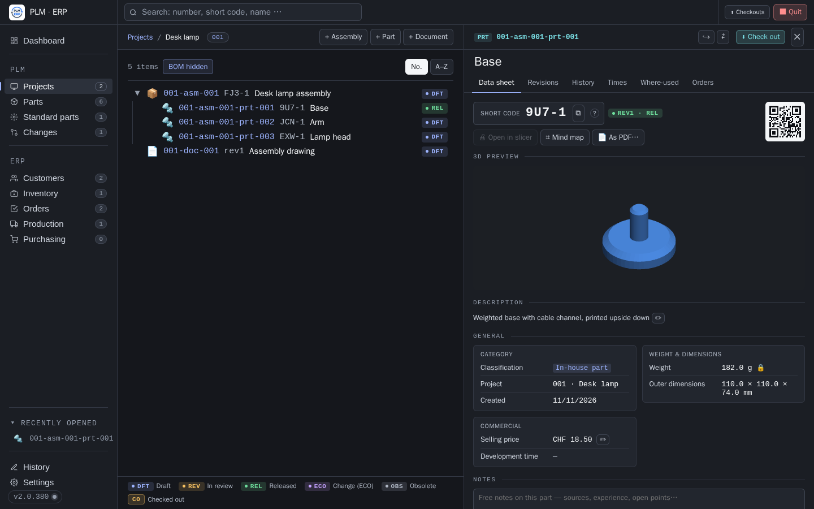
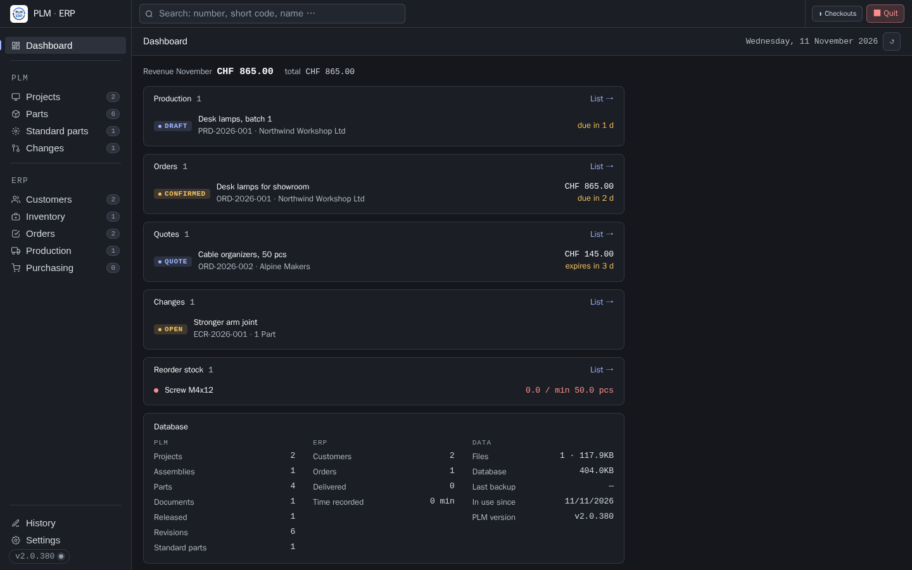
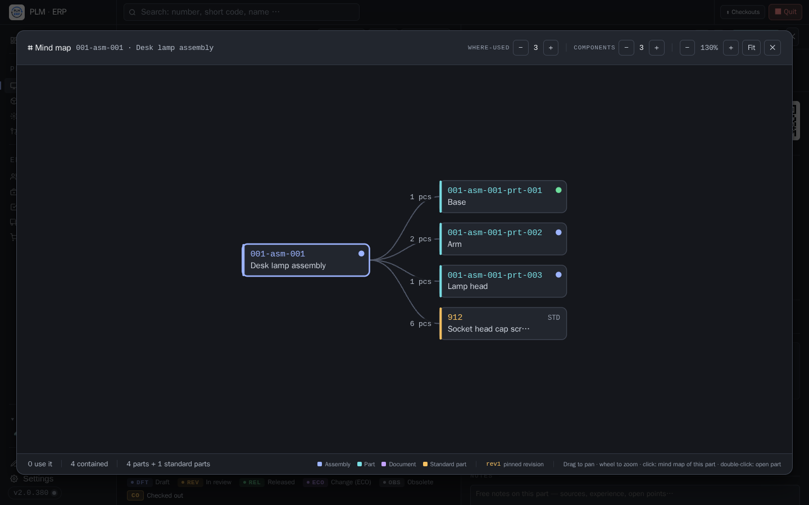
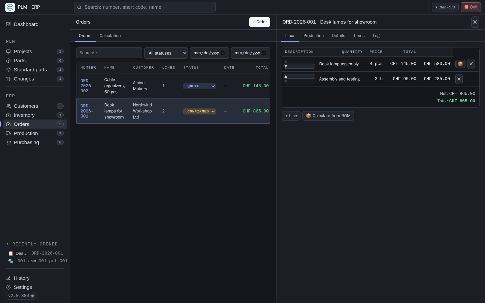
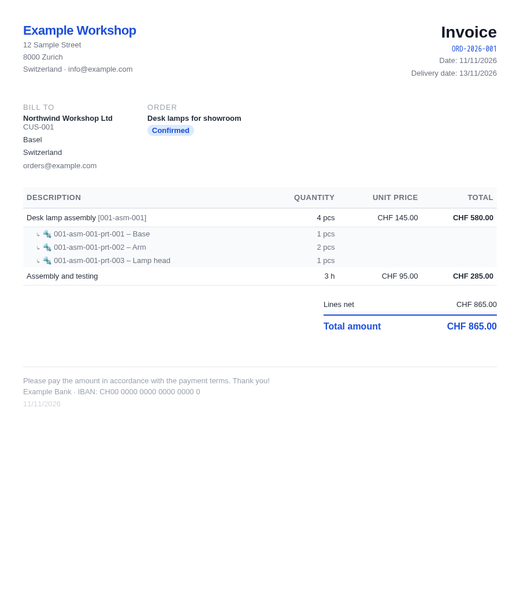

# PLM & ERP – Production Management

[Deutsch](README.de.md) · **English**

A self-hosted PLM and ERP system for small workshops, makers and 3D-printing shops,
inspired by Teamcenter.  
Runs locally on Linux and Windows: no internet connection, no cloud, no account.

## What sets it apart

- **🔌 Your PC, your data** — runs entirely offline on one PC, no cloud, no account, no
  subscription. Several PCs can share the data on a network drive.
- **🖨 Made for 3D printing** — drop in a `.3mf` and PLM takes over layer height, infill,
  temperatures, material and printer, and calculates costs from weight and print time.
- **🏷 A short code on every part** — print `9U7-1` on the part; typing or scanning it opens
  exactly that part in exactly that revision.
- **🚚 Knows what each customer received** — on delivery, PLM pins the revision of every part,
  down to the full assembly structure: "which customer has which revision?" is one click.
- **🔎 Traceability for recalls** — which material lot went into which production order,
  customer and part, and back again.
- **📐 CAD check-out / check-in** (built for Solid Edge) — only changed files come back,
  released revisions stay locked, changes go through an ECO.
- **📄 PLM and ERP in one** — from part to quote, order, production, delivery note and invoice.
  Interface in English or German, documents in their own language.



<table>
  <tr>
    <td width="50%"></td>
    <td width="50%"></td>
  </tr>
  <tr>
    <td align="center"><sub>Dashboard: what is open and due</sub></td>
    <td align="center"><sub>Mind map: BOM and where-used as a graph</sub></td>
  </tr>
  <tr>
    <td width="50%"></td>
    <td width="50%"></td>
  </tr>
  <tr>
    <td align="center"><sub>Order with lines and production</sub></td>
    <td align="center"><sub>Invoice, generated as PDF</sub></td>
  </tr>
</table>

**What it covers**

- **PLM:** projects, assemblies, parts and documents with revisions, BOMs, release
  workflow (Draft → Released → ECO), change requests, CAD check-out/check-in, 3D preview
  for STL and STEP
- **ERP:** customers, quotes and orders, production orders with delivery notes, invoices,
  inventory, raw material with lot tracking, purchasing, traceability
- **3D printing:** print parameters read straight from `.3mf` files (PrusaSlicer, OrcaSlicer,
  Bambu Studio, SuperSlicer), cost calculation from part weight, print time and labour

> **🚀 [Quick start](QUICKSTART.md)** — the essentials on one page
>
> **Language:** the user interface is available in **English and German** (Settings → Data →
> Appearance), printed documents have their own language (Settings → Company). The
> step-by-step [manual](HANDBUCH.md) is currently only available in German.

---

## Installation and start

Requires [Node.js](https://nodejs.org) (LTS).

**Linux:**
```bash
cd backend && npm install && node server.js
```

**Windows:**  
Double-click **`START-PLM.bat`**  
Desktop shortcut with logo: run **`VERKNUEPFUNG-ERSTELLEN.bat`** once

→ The browser opens by itself at `http://localhost:3000`, or at the next free port if 3000
is taken (remembered in `plm.config` as `port=`).  
All Node packages are installed automatically on first start.  
`plm.config` is created automatically if it is missing.

### Avoiding the Windows security warning

Windows marks everything downloaded from the internet and asks for confirmation before
running a `.bat` file ("The publisher could not be verified"). The file extension does not
matter: `.cmd` or `.exe` show the same warning. The fix is to unblock the ZIP file **before
extracting** it, so that none of the extracted files carry the mark.

1. Right-click the downloaded ZIP file → **Properties**
2. On the **General** tab, at the bottom next to *Security: This file came from another
   computer …*, tick **Unblock**
3. Click **OK**, then extract the ZIP file

Already extracted without unblocking? Confirm the warning once with **Run anyway**.
`START-PLM.bat` then removes the mark from itself and no longer warns.
Using `git clone` instead of the ZIP download avoids the warning entirely: Git does not
mark files.

### Data on a network drive (several PCs)

The data can live on a network drive while PLM runs on each PC. Each PC then checks out
into its own local folder, and the CAD program works with local files.
In `plm.config` on each PC:

```
data_dir=Z:\PLM-Data               ← the shared data folder, as it is named on this PC
checkout_dir=C:\CAD\Checkout       ← this PC only (also under Settings → Data)
```

Only one PLM works with the data at a time: each one keeps the database in memory and
writes it back as a whole. `plm.lock` in the data folder records which PLM has it (PC,
process, heartbeat every two minutes). If one is already running at start-up, PLM loads
nothing and asks in the browser whether to take over; the other one then stops saving and
offers "Continue working here". A lock without a heartbeat for 10 minutes (PC switched off
or asleep) counts as orphaned. In addition, before every save PLM compares `plm.db` with the
state it last read or wrote: if someone else has changed it, it is not overwritten, and
unsaved changes end up in `backups/` as `…-nicht-gespeichert.db`.
If the configured data folder is missing or contains no `plm.db` (network drive not
connected, sync not finished yet), PLM does not silently create an empty database but asks
in the browser (retry / create new); an empty folder and `backend/data` count as new.
That is why the server, not `START-PLM.bat`, creates the folder. Every checkout is also
recorded with the PC name in the `checkouts` table so the other PCs can see it. And the
database remembers in `settings.data_stand` which PLM version last opened it (compared by
commit date): an older version only opens it after confirmation.
A real network drive (SMB/NAS) is safer for this than a sync folder (Proton Drive,
OneDrive), which syncs with a delay. Usage: see [HANDBUCH.md](HANDBUCH.md), chapter 2.

---

## Numbering scheme

```
Project:               0028
Assembly:              0028-asm-001
Sub-assembly:          0028-asm-002
Part in assembly:      0028-asm-001-prt-001
Part in project:       0028-prt-001
Document:              0028-doc-001

Orders / quotes:       AUF-2026-0001
Production order:      LS-2026-0001
Purchase order:        EK-2026-0001
Customers:             KD-0001
Suppliers:             LF-0001
```

Prefixes, digit counts and the revision format can be configured under
**Settings → Admin**.

---

## Release workflow

```
DFT ──────────► REL ──► ECO ──► (new revision in DFT)
 │               ▲        └──► OBS (obsolete)
 └──► REV ───────┘   (only with two-person approval)
       └──► DFT (back)
```

Working alone or without two-person approval, you release directly from draft. With
two-person approval (Settings → PLM, from two people on), a revision first goes into review
(REV) and is locked there; only a person other than the one who submitted it may then
release it. Admins may also release their own submissions.

| Status | Meaning |
|--------|---------|
| DFT | Draft: work in progress |
| REV | In review |
| REL | Released: in production use |
| ECO | Engineering Change Order: the revision stays valid and locked, changes are made in a new DFT |
| OBS | Obsolete: superseded, archived |

On ECO, the files, BOM and print parameters of the released revision are carried over into
the new DFT revision, just like with "＋ New revision".  
If the DFT revision is deleted, the ECO automatically returns to REL.  
When the new revision is released, the previous one (REL or ECO) becomes OBS.

**Checks before release** (Settings → PLM): selectable mandatory items: at least one file,
CAD file, drawing (PDF), description, classification, weight (default: file and weight),
plus the properties marked as mandatory for the classification. If something is missing,
PLM names it and disables "Release".

**Working without release:** under **Settings → PLM → Release workflow** you can switch to
simple mode. All revisions then stay in DFT and editable; instead of "Release" there is
**"＋ New revision"**, which carries over the files, print parameters and BOM of the
previous revision. Meant for working alone, without a review step. Existing released
revisions remain untouched, and the ECO path is still available for them.

**Change requests (ECR):** a change request records *why* something should change before
anyone starts designing: reason, affected parts and their impact on assemblies (all
levels), open orders and quotes, open production and stock. Open → Approved or Rejected →
Implement (creates the revision to work in for each part) → Done.

---

## Features

### PLM
- Projects with a configurable number (4 digits by default)
- Assemblies (ASM), parts (PRT) and documents (DOC) with meaningful numbers
- Any hierarchy depth (ASM within ASM)
- **Project colours**: give each project a colour; it shows as a stripe in the list,
  colours the number tile and marks the open project in the breadcrumb
- Revision management rev1, rev2, … (all old revisions are kept)
- Release workflow: DFT → REL → ECO → new revision, optionally with two-person approval (REV)
- **Change requests (ECR)** with impact analysis
- BOM per revision: add several lines at once (cart)
- Standard parts usable in BOMs
- Files per revision: CAD, G-code, PDF, images, documents …
- Automatic file type detection (STL/3MF/STEP → CAD, .gcode → G-code …)
- Weight per part (editable inline), development time tracking; assemblies without their
  own weight sum up the parts and standard parts in their BOM
- **Classification**: coloured chips, configurable under Settings → PLM
- **Properties per classification**, e.g. material, surface finish, manufacturer; shown on
  the data sheet, on the PDF and in search, optionally mandatory for release
- **Thumbnails**: hovering a row in the project tree, BOM or search shows the STL or STEP
  of the latest revision drawn isometrically (for assemblies the STEP first, otherwise the
  image from the 3MF or an uploaded image), computed once and cached under `thumbs/` in
  the data folder
- **3D preview for STL and STEP**: STEP is meshed once with OpenCascade
  (`occt-import-js`, offline) and also stored under `thumbs/`
- **Data sheet tab**: description, source, key figures, print parameters, BOM summary,
  stock, free notes, QR code of the item number and last change at a glance
- **Mind map**: dependencies as a graph: on the left the assemblies that use the item,
  on the right the parts it is made of (see below)
- **Revision in the BOM**: follows the current revision automatically by default, can be
  pinned per line (see below)
- **As-delivered configuration**: on delivery, the revision of each line is pinned, for
  assemblies the whole structure; delivered revisions are locked (see below)
- **Compare revisions**: put two revisions of an item side by side: header data, print
  parameters, BOM, standard parts and files (see below)
- **Release workflow can be switched off**: under Settings → PLM, choose between the
  release process (DFT → REL → ECO, optionally with review REV) and simple mode without
  release
- **Print parameters from 3MF**: uploading a `.3mf` to a revision automatically takes
  over layer height, infill, infill pattern, temperatures, material and printer
- **Automatic classification**: new items are classified as in-house or purchased parts
  based on their source (defaults under Settings → PLM)
- **Free notes** per item, for everything that does not belong in the description
- **Where-used**: shows all revisions of the assemblies an item is built into, including
  the revision each usage is pinned to
- **Variants**: link items as variants; navigate between variants directly in the detail view
- **Document templates**: PDF templates from the item detail: data sheet, BOM, inspection report
- **Item comparison**: compare two items side by side (header data, BOM diff, files)
- **BOM import from STEP**: read a BOM automatically from a Solid Edge STEP export
- **Standard parts**: separate database for standard parts (DIN/ISO/EN) with files
- Check-out/check-in for CAD files
- Complete **history** of all changes (Navigation → History, exportable as CSV)

### ERP
- Customer management (KD-0001)
- Customer can also be entered as free text
- **Quote as an order phase**: one record instead of two (see below)
- Orders with invoice PDF, including labour time as a line item
- Accepting a quote is a phase change: same number, same lines
- **Deleting a customer keeps the documents**: the name moves into the free-text field,
  invoices can still be reprinted in full
- Link PLM items to order lines
- Stock check when booking out
- **Production within the order**: "Production" tab in the order detail: lines, raw
  material, print parameters, delivery note and status without switching to the
  production list
- **Status follows along**: creating a production order confirms the order, the last
  delivered production order sets it to "Delivered", and after printing the invoice
  "Invoiced" is offered
- **Material consumption on completion**: consumed raw material is calculated when setting
  "Delivered" and booked out of the lot after confirmation (see below)
- **Traceability**: per production order line the revision, the material lot used and the
  inspection result; in reverse, for each raw material lot, which production orders,
  customers and parts it went into (for a recall)

### Purchasing
- **Supplier management** (LF-0001) with contact, address and linked stock items
- **Purchase orders** (EK-2026-001): DRAFT → ORDERED → RECEIVED / CANCELLED
- Lines with quantity, unit, unit price, linkable to a stock item, raw material or
  **standard part**
- Standard parts: on the first goods receipt a stock item is created automatically and
  linked permanently, so nothing is maintained twice
- **Purchase order PDF**, ready to print or send to the supplier
- **Goods receipt**: stock items and raw material are booked in automatically
- For raw material: lot number prompt per material, choose the same or individual lot numbers
- For quantity > 1: lot number can be entered per unit

### Quote calculation
When adding a line, the following costs can be calculated automatically:
- **Material**: part weight × raw material price/weight (lot-specific)
- **Labour**: estimated hours × hourly rate
- **Print time**: print hours × printer CHF/h
- **From BOM**: the "📦 Calculate from BOM" button in the order (also in the quote phase)
  expands an assembly into individual lines

### Raw material
- Separate management with material type, colour, dimensions, weight, print parameters
- Lot tracking: every booking-in with lot number and purchase price
- Remaining quantity per lot; used-up lots are struck through or hidden
- When selected in production: nozzle and bed temperature are taken over automatically

### Standard parts
- Catalogue of standardised components (DIN, ISO, EN, …)
- Automatic designation from standard + number + size + material
- Weight per piece, counted in the assembly weight
- Files (STEP, PDF, …) can be attached per standard part
- Usable as BOM lines in assemblies
- **⬇ Check out**: copy all standard part files into a fixed `normteile/` folder

### Production
- Standalone or linked to an order
- Raw material assignable per line (takes over print parameters)
- Read print parameters directly from a 3MF file (PrusaSlicer, SuperSlicer, OrcaSlicer, BambuStudio)
- **Delivery note PDF** with lines, revision, print parameters and signature fields
- **As-delivered configuration**: every line shows its revision; it is pinned on delivery
- Receipt printing on a **Pipsta Classic thermal printer**

### Dashboard and search
- Dashboard with open orders, quotes, due production orders, expiring quotes and open
  change requests
- Global search (`Ctrl+K`) across projects, PLM items, orders and quotes, production orders,
  customers, raw material and files; with several words, all of them must match
- **Filter by classification**: chips with hit counts, even without a search term (see below)
- PLM items (PRT/ASM) appear first in search, sorted by relevance

### Navigation
- **Ctrl+K**: open search
- **Escape**: close modal / detail
- **Browser back button**: navigates within the app
- **Recently opened**: recently opened items and documents in the sidebar

### Settings / Admin
- **Data** (opens first): interface language, font size, **reset design**, data path, checkout
  folder, CAD program, **create and restore backups**, export
- **Company**: name, address, bank details, logo, document language
- **Calculation**: hourly rate, machine costs, defaults
- **3D printing**: slicer (PrusaSlicer / Bambu Studio), printers, nozzles, material profiles
- **PLM**: classification list (name + colour, drag & drop; renaming carries over to the items)
- **Users**: who works with PLM (user, superuser, admin); names in history and release
- **Admin**: numbering structure, deleting records

---

## Revision in the BOM

A BOM line refers to the **part**, not to a fixed revision. By default it therefore
always shows the current state: when the part is raised to rev2, all assemblies follow
automatically. That is right for most assemblies and stays unchanged.

For cases where a real, deviating state has to be documented, a line can be **pinned to
a revision**. Clicking the revision badge in the BOM line opens the choice:

| Choice | Behaviour |
|---|---|
| **Automatic** (default) | always follows the active revision |
| **Pinned to revN** | stays on this revision even when newer revisions appear |

Pinned lines are marked with a lock. If a newer revision exists by now, an additional
hint (`↑rev2`) appears in amber, so the old state is clearly deliberate, not forgotten.

**Typical use case:** vehicles or delivered devices set up as an assembly (ASM). When a
component is revised, the units that have not been upgraded yet stay on their revision.
The component's "Where-used" tab then shows directly which unit is on which revision.

For deliveries to customers this no longer has to be done by hand; see
**As-delivered configuration**.

If a pinned revision is deleted, the line automatically falls back to "Automatic", so
there are no dead references.

---

## As-delivered configuration

A production line linked to an item follows the active revision until delivery (faint
badge `rev2`). As soon as the production order is set to **"Delivered"**, PLM records
what is actually at the customer:

| What | How |
|---|---|
| Part | the revision of the line is pinned (`🔒 rev2`) |
| Assembly | additionally the **complete structure**: every sub-part with its revision at the time |
| Delivered revision | locked: no changes to files, BOM or print parameters, no deletion |
| Item with a delivered revision | can only be deleted under **Settings → Admin** |

Further work happens in a **new revision**: the Revisions tab shows "＋ New revision" for
this, also in the workflow with release. If a check-in changes files of a delivered
revision, PLM asks and creates a new revision for them.

- **Before delivery**, a line can be set to a revision by hand via the badge (e.g. when
  rev1 is deliberately still being printed).
- **After delivery**, clicking the badge shows the delivered configuration with its
  structure. If the wrong revision was recorded, it can be corrected there.
- **Status back** (e.g. to "Ready"): automatically pinned revisions follow the active one
  again, manually chosen ones stay.
- If a newer revision exists by now, `↑rev3` appears next to it.
- Item → **Orders** tab shows the delivered configuration per production order, also for
  parts delivered as part of an assembly (section "Delivered as part of an assembly"). This
  is how PLM answers the question of which customer has which revision.
- The delivery note prints the revision for each line.

**Existing deliveries:** on first start, PLM determines for already delivered production
orders the revision that was active on the delivery date. These lines carry the note
"determined".

---

## Compare revisions

In the Revisions tab of an item with several revisions, **"⇄ Compare revisions"** opens
the comparison. By default the selected revision is compared with the next older one;
both sides can be chosen and swapped.

| Area | Compared |
|---|---|
| Header data | status, description, ECO reason, release |
| Print parameters | every value, with the same labels as on the data sheet |
| BOM | added, removed, quantity changed, revision pinning changed |
| Standard parts | added, removed, quantity changed |
| Files | matched by name without `_revN`; for equal size a checksum decides |

A file copied on ECO or "New revision" therefore counts as unchanged.
"Changes only" hides what is identical. The ⇄ button in the title bar still compares two
**different** items.

---

## Mind map: dependencies

The ⌗ button in the title bar of an item (or in the data sheet tab) opens the dependency
graph:

```
Assemblies that use it  ──►  [ Item ]  ──►  Parts it is made of
     (Where-used)                               (BOM)
```

- **Drag** to pan, **mouse wheel** to zoom
- **Click** re-centres the mind map on the clicked part, which lets you navigate the
  structure; **double-click** opens the item
- Depth adjustable separately for both directions (0–6 levels)
- Standard parts appear as leaves, quantities are shown on the edges
- Pinned lines show the revision in amber; the graph then expands the sub-BOM of
  **that** revision, not of the latest one
- Usages that only exist in older revisions are counted and reported in the footer

---

## Search and classification

Search (`Ctrl+K` or click into the search field at the top) finds items whose number,
name, description, notes or classification contain **all** the words entered:
"holder PETG" finds a holder that has "PETG" in its description.
Upper and lower case do not matter, umlauts included.
An exactly entered item number is always at the top.

The **chips** above the results are a real filter:

- Clicking a classification shows only items of that classification, even without a
  search term, as a list of the class. A second click removes the filter.
- The number on the chip applies to the current search term; chips without hits are faded.
- **none** shows items that have no classification yet.
- Dashed chips are values that are set on items but are not (or no longer) in the list.

Under **Settings → PLM**, each classification shows how many items carry it. Renaming
carries the new name over to all items and to the default classification on save. When
removing a classification that is in use, PLM asks whether the items keep or lose it.
Values that are set on items but missing from the list can be brought back with
"＋ add". Spellings like " purchased " are mapped to the list entry "Purchased" on save.

---

## Quote as an order phase

Quote, order and production order used to be three records in three lists for the same
transaction. The quote is now the first **phase** of an order:

```
Quote ──► Confirmed ──► Delivered ──► Invoiced
  │
  └──► Rejected            Draft ──► Confirmed   (order without a prior quote)
```

- A new transaction starts either as a **quote** or as a **draft**
- In the quote phase, the document button prints the **quote PDF**, otherwise the invoice
- "Quote accepted" changes the phase: **no new number, no new record, the lines stay**
- "Valid until" only appears in the quote phase

**Migration:** on first start, existing quotes are moved to the new form automatically.
They keep their ANG number so that printed documents can still be matched; the original
number is also stored in the `origin_quote_number` field. Quotes that had already been
converted into an order are skipped, since their order already exists. The old quotes
table only remains for this migration; there is no separate view or API for it anymore.

---

## Production within the order

A production order remains a record of its own with its own number, so delivery notes
and history carry on unchanged. It is edited within the order, though:

| Where | What |
|---|---|
| Order → **Production** tab | lines, raw material, print parameters, delivery note, status |
| Several production orders | as sub-tabs in the same tab (partial deliveries remain possible) |
| Navigation → **Production** | shows only **standalone** production orders without an order by default |

The order only counts as delivered once all its production orders have been delivered.
Production orders linked to an order show the order number in the production list and
jump straight to the order's "Production" tab when clicked.

---

## Material consumption on completion

Raw material is managed in **spools** (`stock_qty`), consumption is in **grams**. The
system converts via `weight_g` (weight of a full spool): 1840 g on a 1000 g spool is
1.84 pcs.

When a production order is set to "Delivered", a breakdown of the lines with assigned raw
material appears. The weight per piece is taken in this order:

1. Filament weight entered on the production line
2. `filament_weight_total` from the print parameters of the linked item
3. Stored part weight

Quantities and lots can be corrected in the dialog; lots are suggested by FIFO.
Nothing is booked until confirmed; "Don't book out" leaves everything unchanged.
Lines without weight or without spool weight are listed separately and left untouched.
Each production order is booked out only once.

---

## Check-out / check-in (CAD workflow with Solid Edge)

### Solid Edge: set the default path

**Tools → Options → File Locations**

| File type | Path |
|----------|------|
| Parts (.par / .psm) | checkout folder |
| Assemblies (.asm) | same path |
| Drafts (.dft) | same path |

Checkout path: **Settings → Data → Checkout directory**, per PC, stored in `plm.config` as
`checkout_dir=` (empty: `[data directory]/checkout`). It used to be stored in the database;
if that folder exists on the PC, PLM takes it over once at start-up.

### Workflow

```
1. Item → "⬇ Check out"
   → files in <checkout-path>/<item-number>/ (no timestamp → the path stays the same)

2. Edit in Solid Edge

3. → "⬆ Check in" → only changed files are taken over, the folder is deleted.
   If the part is no longer in draft by then (released, in review, obsolete,
   delivered), PLM asks first: upload as a new revision or discard

4. New files → PLM detects them automatically when the checkout overview is opened
```

### Checking out standard parts

Navigation → Standard parts → **⬇ Check out** copies all standard part STEP files into
`<checkout-path>/normteile/`. The folder name is always the same, so it only needs to be
configured once as a search path in Solid Edge.

---

## Pipsta Classic: setup (Windows, once)

```
pip install pyusb
```

Install the Zadig driver: [zadig.akeo.ie](https://zadig.akeo.ie) → Pipsta → WinUSB

| Error | Solution |
|---|---|
| LED blinks red/green | use the power supply |
| `Kein WinUSB-Gerät gefunden` (no WinUSB device found) | reinstall the Zadig driver |
| `pyusb nicht installiert` (pyusb not installed) | `pip install pyusb` |
| Characters `@B` at the start | switch the printer off and on |

---

## 3MF print parameters

When adding a production line, a `.3mf` file can be uploaded.

| Slicer | Supported |
|--------|-----------|
| PrusaSlicer 2.x (incl. 2.9+) | ✓ |
| SuperSlicer | ✓ |
| OrcaSlicer | ✓ |
| BambuStudio | ✓ |

---

## Terminology

So that the interface, documents and manual speak the same language. This list is also
the reference for the English translation of the interface.

| German (UI) | English | Meaning |
|---|---|---|
| Item | **Item** | umbrella term for assembly, part and document in PLM |
| Baugruppe (ASM) | **Assembly** | item with a BOM |
| Part / Bauteil (PRT) | **Part** | single part |
| Dokument (DOC) | **Document** | item that is not manufactured, e.g. a drawing |
| Item-Nummer | **Item number** | `0028-asm-001-prt-001` |
| Revision | **Revision** | state of an item, written `rev1`, `rev2` |
| Stückliste / BOM | **BOM** (bill of materials) | lines of an assembly revision |
| Datei | **File** | file attached to a revision (CAD, PDF, …) |
| Klassifizierung | **Classification** | category of an item, e.g. in-house part, purchased part |
| Eigenteil / Kaufteil | **In-house part / Purchased part** | default classifications |
| Verwendung | **Where-used** | which assemblies an item is used in |
| Historie | **History** | log of all changes |
| Status DFT / REV / REL / ECO / OBS | **Draft / In review / Released / Change (ECO) / Obsolete** | revision status |
| Freigabe / freigeben | **Release / release** | |
| Vier-Augen-Prinzip | **Two-person approval** | release by a second person |
| Änderungsantrag (ECR) | **Change request (ECR)** | reason and impact of a planned change |
| fixiert | **pinned** | set to a fixed revision (BOM, as-delivered configuration) |
| Gelieferter Stand | **As-delivered configuration** | revisions pinned on delivery of a production order |
| Auschecken / Einchecken | **Check out / Check in** | |
| Datenblatt | **Data sheet** | |
| Normteil | **Standard part** | DIN/ISO/EN component |
| Auftrag | **Order** | transaction with phases Quote → Confirmed → Delivered → Invoiced |
| Angebot | **Quote** | first phase of an order |
| Rechnung | **Invoice** | |
| Produktionsauftrag | **Production order** | manufacturing job, number `LS-…` |
| Lieferschein | **Delivery note** | printout of a production order |
| Rückverfolgung | **Traceability** | |
| Lager / Lagerartikel | **Inventory / Stock item** | |
| Rohmaterial | **Raw material** | |
| Lot-Nr. | **Lot no.** | batch of a raw material |
| Einkauf / Bestellung | **Purchasing / Purchase order** | |
| Wareneingang | **Goods receipt** | |
| Lieferant / Kunde | **Supplier / Customer** | |
| Verkaufspreis (VP) | **Selling price** | price of an item |
| Stundenansatz | **Hourly rate** | |
| Sicherung | **Backup** | copy of the database in `data/backups/` |
| Papierkorb | **Trash** | deleted files, kept for 30 days |
| Einstellungen | **Settings** | |
| Beleg | **Document** | printed or PDF document: invoice, quote, delivery note … |

Number prefixes: existing databases keep their prefixes (AUF, LS, EK, KD, LF). New
installations with the English interface start with English defaults (ORD, PRD, PO, CUS, SUP).
Prefixes remain configurable under Settings → Admin.

---

## Translating the interface

The interface language is chosen under **Settings → Appearance** (stored on the server like
the colour scheme). Without a choice, PLM follows the browser language; installations that
already had data before the translation keep German.

The German text is the key: code writes `_t('Speichern')`, and
[`frontend/public/lang/en.js`](frontend/public/lang/en.js) maps it to `'Save'`.
Placeholders use braces: `_t('… und {n} weitere', { n: 3 })`. A missing entry simply shows
the German text, so the interface can be translated file by file. Static text in
`index.html` (text, `title`, `placeholder`) is translated once on load without any markup;
`data-no-i18n` excludes an element. `npm test` checks that every `_t('…')` has an entry.
Units are stored as language-neutral codes (`pcs`, `set`, `flat`; physical units such as
`g`, `m`, `h` as they are). The server turns input like "Stk" or "Stück" into `pcs`, and
`_unit()` shows the code in the interface language.

The whole interface, the start screen, all printed documents, the server's error messages
and the history actions are translated. The server sends its messages in German and
translates them into the language the browser sends (`X-PLM-Lang`), using the same
`lang/en.js`; `npm test` requires an English entry for every fixed server message. History
entries are stored in German as before; their action is translated when shown, details stay
as recorded.

**New installations:** the first time an empty installation is opened, PLM stores the
browser language. With English it also starts with English defaults: payment terms, invoice
and quote footers, classifications (In-house part, Purchased part, …) and number prefixes
(ORD, PRD, CUS, PO, SUP). Existing installations keep German and their own texts.

**Document language:** printed documents (invoice, quote, delivery note, purchase order, data
sheet, BOM, inspection report, labels, thermal printer receipts) have their own language under
**Settings → Company**, independent of the interface. Installations that already had data keep
German. In code, `_d('…')` translates into the document language, `_k('…')` only marks a key
for tables shared by interface and documents (like gettext's `N_()`). Footers and payment terms
are printed exactly as entered in the settings.

Where the same German word has two meanings, a context prefix separates the translations:
`_t('@lock:Übernehmen')` shows "Übernehmen" in German and the `@lock:` entry in English. Contributions
are welcome, please use the terms from the table above.

---

## File structure

```
PLM/
├── backend/
│   ├── server.js          ← REST API (Express + sql.js/SQLite)
│   ├── package.json
│   ├── print_receipt.py   ← Pipsta print script (Python, ESC/POS)
│   └── data/              ← created automatically (not in Git)
│       ├── plm.db         ← SQLite database
│       ├── files/         ← uploaded files (UUID names)
│       ├── backups/       ← database backups (see Backups)
│       ├── papierkorb/    ← deleted files, kept for 30 days
│       └── plm.lock       ← which PLM currently holds the data (while it runs)
├── frontend/
│   └── public/
│       ├── index.html     ← HTML skeleton
│       ├── lang/en.js     ← English translation (German text → English)
│       ├── js/            ← single-page app, split by domain
│       │   ├── 00-i18n.js    ← interface language: _t(), language switch
│       │   ├── 01-core.js …  13-normteile-einkauf.js
│       │   ├── 14-qr.js      ← QR encoder (standalone, no external library)
│       │   ├── 15-mindmap.js ← dependency graph (SVG, pan/zoom)
│       │   └── (load order in index.html, shared global scope)
│       └── styles.css     ← design system (dark theme, high-contrast palette)
├── plm.config             ← configuration of this PC: data_dir, checkout_dir, port, cad_path, prusaslicer, bambustudio, crealityprint (created automatically)
├── docs/
│   ├── images/            ← README screenshots (en, de)
│   └── make-screenshots.js ← regenerates them from demo data
├── HANDBUCH.md            ← user manual (German)
├── QUICKSTART.md          ← quick start (English)
├── SCHNELLSTART.md        ← quick start (German)
├── START-PLM.bat          ← launcher for Windows
├── VERKNUEPFUNG-ERSTELLEN.bat ← creates the desktop shortcut with logo (Windows)
├── PLM-ERP.ico            ← logo as Windows icon for the shortcut
├── README.md              ← this file
└── README.de.md           ← German version
```

---

## Security

PLM has no login: whoever can reach the interface may do everything. The server listens
on port 3000 (or the remembered fallback port) on all network interfaces. Whether other
devices can reach it is decided by the PC's firewall.

- Requests from other websites (foreign origin or host) are rejected; there is no CORS allowance.
- CAD, slicer and "Open folder" start without a shell and only for requests from the PC itself.
  Program paths are stored in `plm.config`, not in the interface.
- Check-in and import only work inside the checkout directory, and it can only be changed
  on the PC itself (it is stored in `plm.config`). Taking over the data lock also only
  works on the PC itself.
- Check for package vulnerabilities: `cd backend && npm audit --omit=dev`

Users (Settings → Users) are for traceability, not for protection: they are selected
without a password; each person can protect their tile with a PIN. Usage: see
[HANDBUCH.md](HANDBUCH.md), chapter Settings → Users.

---

## Installing updates

The easiest way is from within PLM: click the version at the bottom of the navigation
(blue dot) → **Install now**. PLM fetches the new version (`git merge --ff-only` or the
ZIP from GitHub), runs `npm install` if packages changed and restarts; the page reloads
itself afterwards. This only works on the PC where PLM runs and, in a Git checkout, only
without uncommitted changes of your own. If something fails, the previous version keeps
running. When started via `START-PLM.bat` or `start-plm.sh`, the script restarts PLM
(exit code 75); otherwise PLM restarts itself and replaces the old process.

By hand:

```bash
git pull
cd backend && npm install     # only needed if packages were added
node server.js
```

The database and `plm.config` live outside the repository and are listed in
`.gitignore`, so a pull does not touch them.

The running version is shown at the bottom of the navigation below Settings and on the
start screen: `2.0.282` = major.minor from `backend/package.json`, followed by the number
of commits. The dot next to the version: blue = update available, green = up to date,
grey = unknown (offline or GitHub unreachable; the reason is in the tooltip). "geändert"
(modified; start screen, dashboard, version tooltip) means PLM was started with
uncommitted changes, in which case "Install now" is not available.

**Copy from the ZIP download (without Git):** when downloading, GitHub writes the commit
and date into `backend/version.json` (`export-subst` in `.gitattributes`). With that, PLM
asks GitHub whether there is something newer and also gets the version number from there;
without internet the commit is shown instead of the number. To update: "Install now" as
above, or by hand: stop PLM, download the new ZIP, copy its contents over the PLM folder
and restart. Data and `plm.config` are preserved.

At start-up, PLM checks whether there are newer commits on the Git remote (`git fetch` in
the background, from the running commit on). If there are, the start screen shows an
"Update" line with the new version number, and a blue dot appears next to the version in
the navigation (a click shows the new commits and "Install now"). Installation only
happens on click; PLM keeps running normally on the current version, and while running
the interface checks again every 30 minutes. The check never asks for a password or
passphrase: SSH remotes need a key without passphrase or a running SSH agent. If the
remote cannot be reached, the state of the last fetch counts; without Git or without an
upstream branch it stays silent.

Schema changes run automatically at server start: `initDb()` **first** creates a daily
copy under `data/backups/`, then `applySchema()` adds missing tables and columns and
writes the file back. The process is idempotent; a second start changes nothing. The same
runs after restoring a backup, so that an older backup also gets the current schema.

New settings (release workflow, default classification) start with the previous values:
nothing changes until you switch them.

After an update that affects the colour palette, press
**Settings → Data → Reset design** once: the classification colours are stored in the
database and would not follow otherwise. Names and order are kept.

---

## Backups

Everything is under **Settings → Data → Backup**, while running; no restart needed.
The backups live in `backups/` inside the data directory (`backend/data/` unless
`data_dir` in `plm.config` says otherwise); the settings page shows the full path below the list. "⬇ Download" next to a backup
saves the file through the browser, so you don't have to find the folder.

| Kind | Name in `data/backups/` | Kept |
|---|---|---|
| daily, at server start and checked hourly while running | `plm-YYYY-MM-DD.db` | every day for the last 7 days, then the first of each month for 6 months; the first of each year until you delete it |
| "💾 Back up now" | `plm-YYYY-MM-DD_HHMMSS-manuell.db` | until you delete it |
| before every restore | `plm-YYYY-MM-DD_HHMMSS-vor-wiederherstellung.db` | until you delete it |
| another PLM took over, or `plm.db` was changed from outside, before everything was saved | `plm-YYYY-MM-DD_HHMMSS-nicht-gespeichert.db` | until you delete it |

**Restoring:**

1. Click "Restore" next to the desired backup in the list. The dialog shows the key
   figures of the current state against the backup (projects, items, orders, …).
2. PLM first backs up the current state ("before restore"), so you can go back.
3. The database is swapped and brought up to the current schema.
4. PLM retrieves deleted files that the backup still refers to from the **trash**. If a
   file is still missing, the final dialog names it.

**"⬆ Restore from file…"** does the same with a `.db` backup or a **full export** (`.zip`
with `plm.db` and `files/`). With a ZIP, missing files are restored as well; existing
files are left untouched.

**Trash:** deleted files (file on a revision, project document, standard part file,
deleted item) end up in `data/papierkorb/` and are permanently removed at server start
after 30 days.

**Export:** **Settings → Data → Full export** downloads `plm.db` + `files/` as a ZIP;
"Export with readable names" arranges the files by project/item/revision (for reading,
not for restoring the files).

---

## Tests

```bash
cd backend
npm test
```

The most important test files:

| File | Content |
|---|---|
| `test/sperre.test.js` | shared data directory: waiting and taking over, external changes, orphaned locks, checkout directory per PC, lock when moving, missing data folder, checkout records, data version |
| `test/smoke.test.js` | orders, price sync order ↔ production, stock bookings, backups |
| `test/workflow.test.js` | project colours, classification derivation, 3MF print parameters, revision pinning, simple workflow, standard part purchasing, material consumption, quote phase, customer deletion |
| `test/revisionen.test.js` | as-delivered configuration (pinning, locking, releasing, correction, check-in), revision comparison, ECO carry-over, search with classification, renaming classifications |
| `test/backup.test.js` | creating and restoring backups (list, `.db`, ZIP), trash, schema update of older backups |
| `test/frontend.test.js` | QR encoder (against the ISO reference values), URL sanitising, data sheet, BOM revision display, mind map layout, workflow switching, revision badges in production, revision comparison |
| `test/i18n.test.js` | translation: every `_t('…')` text has an English entry, no unused entries, placeholders match, language default for new and existing installations |
| `test/anonym.test.js` | everything in Git is anonymous: no real e-mail addresses, user paths, IBANs or phone numbers |

The server tests each start their own server (own port) with an empty throwaway database;
`frontend.test.js` tests pure frontend functions without a server and without a browser.

---

## Support

This project is developed in my spare time and is free to use. If it saves you work, I'd be happy about a coffee:

[](https://ko-fi.com/schnarchler)

---

## License

[MIT](LICENSE) — © 2026 Schnarchler

Free to use, modify and distribute, including commercially. The copyright notice must be kept.
The software is provided without any warranty.
